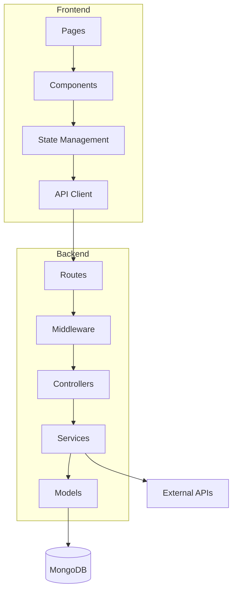
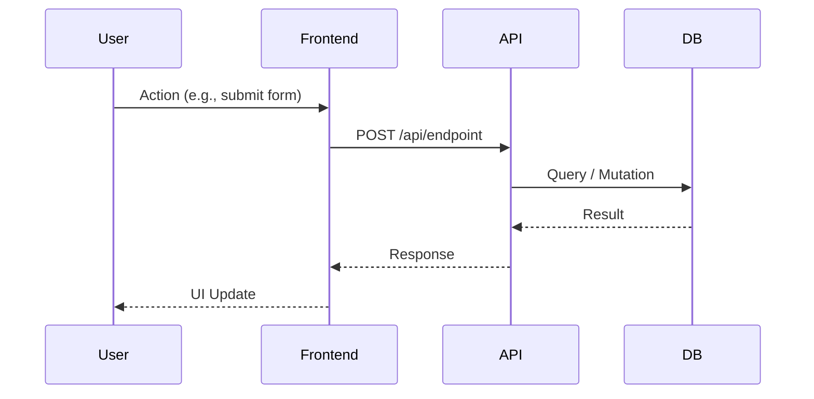
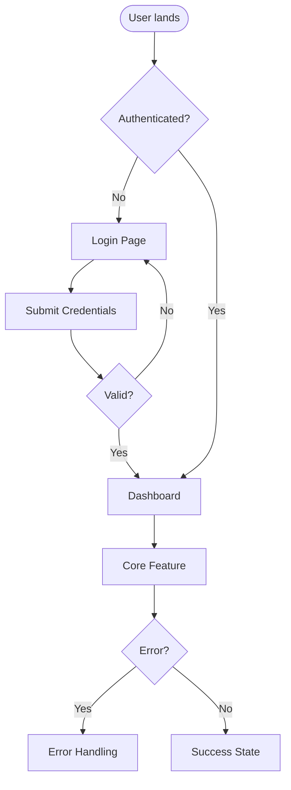

# Generate, Train, and Assess — Phases 5-10 Checklist

This is the step-by-step checklist for documentation, learning path, question
bank, mock interview, and readiness report. Full rationale in `00-workflow.md`.

**PRECONDITION:** Phase 4 verification complete. User has said "looks good" on
the project-understanding report. `project-graph.json` has only
"code-verified" and "user-provided" entries in the main sections
("UNVERIFIED" only in uncertainties/risks).

---

## Phase 5: Documentation Generation

**Create three files in `.project-defense/docs/`. Each uses a dedicated
template in `templates/`:**

### 1. `docs/architecture-overview.md` (from `templates/architecture-document.md`)
- Project purpose (one paragraph)
- Technology stack (table: layer, technology, version)
- Main components (from graph: frontend pages/components, backend
  routes/services, data models)
- Component interactions (text + reference to architecture.mmd)
- Key design decisions (verified only -- cite graph entries)
- Interview-ready summary (3-4 sentences a candidate could say)
- Evidence appendix (table: claim, file, lines)

### 2. `docs/data-flow.md` (from `templates/data-flow-document.md`)
- Overview + primary user journey
- Data flow diagram (embed the Mermaid from diagrams/data-flow.mmd)
- Step-by-step lifecycle (8 stages: user action -> frontend -> network -> route -> controller -> data -> response -> frontend update)
- State transitions (table)
- Async and side-effect flows
- Error propagation paths
- Interview-ready summary
- Evidence appendix

### 3. `docs/core-logic.md` (from `templates/core-logic-document.md`)
- Core features (each gets: what, why, step-by-step, edge cases handled, edge cases NOT handled)
- Business rules (the tribal knowledge)
- Invariants (what must always be true)
- Common failure modes
- Things you'd refactor (be honest — interviewers reward self-awareness)
- Interview-ready summary
- Evidence appendix

**Rule:** Only "code-verified" and "user-provided" entries in main body.
"UNVERIFIED" only in evidence appendix with WARNING badge.

---

## Phase 6: Diagram Generation

**Create three Mermaid source files in `.project-defense/diagrams/`.**

### architecture.mmd (component diagram)

Nodes from graph: pages, components, routes, middleware, controllers, services,
models. Edges from data_flows and api_calls.

### data-flow.mmd (sequence diagram)

Steps from graph data_flows. Show data shape at each arrow.

### user-flow.mmd (flowchart)

Primary user journeys from graph user_flows.

---

## Phase 7: Learning Path

**Create `.project-defense/learning-path.md`.**

**Algorithm:**
1. Scan graph for feature tags: auth, forms, api, database, testing, error-
   handling, realtime, payments, websockets, background-jobs, etc.
2. Map each tag to a stage using the built-in curriculum map (see below).
3. Output table: Stage, Topic, Project Connection, Practice Task.
4. Add Rebuild Challenge as final stage.

**Built-in curriculum map (v1):**
| Tag | Stage | Topic | Practice Task |
|---|---|---|---|
| react | 2 | React basics | Build a counter component |
| forms | 3 | Forms/validation | Recreate the login form |
| api | 4 | HTTP/API | Write a fetch wrapper |
| express | 5 | Node/Express | Add a new route |
| mongodb | 6 | Databases | Write a query for User |
| auth | 7 | Authentication | Implement JWT verify |
| error-handling | 8 | Error handling | Add try/catch to route |
| testing | 9 | Testing | Write test for /api/login |
| (any) | 10 | Rebuild challenge | Recreate auth middleware |

**Output format:**
```markdown
# Personalized Learning Path

Based on your project (React + Express + MongoDB), here is your path:

| Stage | Topic | Project Connection | Practice Task |
|---|---|---|---|
| 1 | JavaScript Fundamentals | Variables, functions in components | Refactor a component to use arrow functions |
| 2 | React Basics | Components in src/components/ | Build a Button component with props |
| ... | ... | ... | ... |
| 10 | Rebuild Challenge | server/middleware/auth.js | Recreate JWT verification from scratch |
```

---

## Phase 8: Question Bank

**Create `.project-defense/question-bank.md`.**

**Generate from graph entries. Four categories:**

### Explanation Questions (3-5)
- "Walk me through the architecture."
- "What happens when a user submits the login form?"
- "How does the frontend communicate with the backend?"
- "Explain the data model for [main entity]."

### Failure Scenarios (3-5)
- "What happens if MongoDB is unreachable?"
- "What if the JWT expires mid-request?"
- "What if an environment variable is missing at startup?"
- "What if the external API times out?"

### Trade-offs (2-4)
- "Why MongoDB over PostgreSQL for this project?"
- "Why Express instead of Fastify/NestJS?"
- "How would you scale the authentication system?"
- "What would you change if traffic grew 10x?"

### Coding Tasks (2-3)
- "Add input validation to the registration endpoint."
- "Write a unit test for the expired-token middleware."
- "Fix this broken authentication flow (agent provides broken code)."

**Each question entry:**
```markdown
### Q: [Question text]

**Why interviewers ask:** [1-2 sentences]

**Expected concepts (rubric):**
- Concept 1
- Concept 2
- Concept 3

**Strong answer:** [2-3 paragraph model answer]

**Weak answers:** [bullet list of common gaps]

**Follow-up:** [One deeper question]

**Coding task (if applicable):** [Task description + acceptance criteria]
```

---

## Phase 9: Mock Interview

**Run the structured interview. Use the question bank. Score each segment.**

### Segment Structure (timeboxes)
1. **Overview (2 min)** -- user summarizes. Score: clarity, completeness.
2. **Architecture (8 min)** -- 2-3 questions from Explanation. Score per rubric.
3. **Deep Dive (10 min)** -- 1 critical flow, detailed follow-ups. Score per rubric.
4. **Failure Scenarios (8 min)** -- 3-4 questions. Score per rubric.
5. **Trade-offs (7 min)** -- 2-3 questions. Score per rubric.
6. **Coding Challenge (10 min)** -- 1 task. User writes code. Score: correctness,
   edge cases, clarity.
7. **Reflection (5 min)** -- "What would you improve?" Score: self-awareness,
   technical depth.

### Scoring
Each rubric concept: 0 (missing) | 1 (partial) | 2 (correct) | 3 (thorough).

**Weights:**
- Deep dive: 25%
- Coding: 25%
- Architecture: 20%
- Failures: 15%
- Trade-offs: 10%
- Overview: 5%
- Reflection: 10%

**Record scores** in a temporary object for Phase 10.

---

## Phase 10: Readiness Report

**Create `.project-defense/readiness-report.md`.**

### Contents
1. **Overall Score** (0-100, weighted)
2. **Strengths** (top 3 segments/concepts with scores)
3. **Critical Gaps** (any concept < 1.5/3 -- list with file references from graph)
4. **Next Steps** (priority ordered):
   - [ ] High: [specific action, file:lines, why]
   - [ ] Medium: [...]
   - [ ] Low: [...]
5. **Unverified Items** (from graph uncertainties -- user must clarify)
6. **Rebuild Challenge Result** (if attempted: pass/fail, notes)

### Example Next Step Format
```markdown
- [ ] **High**: Review JWT token refresh logic in `server/middleware/auth.js:45-62`.
  The interview revealed uncertainty about refresh token rotation. Add a test
  for the refresh endpoint.
- [ ] **Medium**: Add integration test for `/api/users` POST in
  `server/routes/users.test.js` (create file).
```

**Rule:** Every next step must reference a specific file and line range from
the project graph. No generic advice.

---

## Checklist Summary (tick each)

- [ ] Three docs in `.project-defense/docs/` with evidence appendices
- [ ] Three Mermaid files in `.project-defense/diagrams/`
- [ ] learning-path.md with 10-stage table tied to project features
- [ ] question-bank.md with 4 categories, rubrics, sample answers
- [ ] Mock interview run, all 7 segments scored
- [ ] readiness-report.md with score, strengths, gaps, prioritized next steps
  with file references
- [ ] All artifacts committed or shown to user